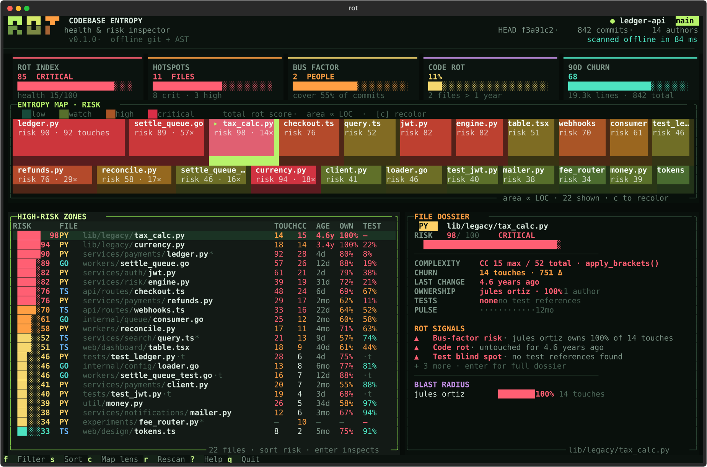

# rot

**A codebase entropy and health inspector for the terminal.**

`rot` scans a local git repository and turns its history and structure into a
single interactive dashboard: churn, complexity, ownership concentration, test
signal, and the files that have quietly stopped changing. It runs entirely
offline, reading git logs and source files — it never runs your tests or sends
anything over the network.



## Quick start

```bash
pip install -e .
rot --demo            # explore a deterministic demo repository
rot ~/code/project    # scan a real checkout
rot --once            # print a static report, no TUI
rot --json            # machine-readable snapshot for CI
```

`rot` is a Python 3.10+ package built with [Textual](https://textual.textualize.io/)
and [Rich](https://rich.readthedocs.io/).

## The dashboard

- **Entropy map** — a banded, area-proportional treemap where area is
  source-line mass and color is the selected lens. Wide horizontal bands keep
  filenames readable instead of squeezing them into slivers. Press `c` to
  recolor by risk, churn, age, or complexity. Click a tile to jump to that file.
- **High-risk zones** — a sortable leaderboard of source files with risk, churn,
  complexity, age, ownership share, and test signal. `s` cycles risk, churn,
  complexity, age, and path. `/` filters paths live.
- **File dossier** — selected-file metrics, rot signals, test signal, commit
  pulse, and contributor blast radius. `enter` opens the full dossier with
  concrete first moves.
- **Repo signals** — rot index and health, critical/high hotspots, bus factor,
  stale-file share, and 90-day churn.

Keys: `↑↓` move, `g`/`G` jump to first/last, `enter` inspect, `/` or `f` filter,
`s` sort, `c` map lens, `r` rescan, `esc` clear/close, `?` methodology, `q` quit.

The layout responds to the terminal. At 150×48 the split leaderboard and
dossier are both visible; below 96 columns or 44 rows the dossier collapses and
the leaderboard takes the full width; at 80×24 the brand also compresses so the
map and table keep usable rows. Columns resize to fit, so the table never
scrolls sideways.

## Supported files

`rot` analyzes 50+ source extensions across Python, JavaScript, TypeScript, Go,
Rust, Java, Kotlin, C/C++, C#, Ruby, PHP, Swift, Scala, Shell, Lua, SQL, Vue,
Svelte, Dart, Elixir, Erlang, Clojure, Haskell, OCaml, Zig, Nim, Perl, Groovy,
F#, and Solidity. Common generated, vendored, and tool directories such as
`.git`, `node_modules`, `vendor`, `dist`, `build`, `coverage`, and caches are
ignored automatically, as are minified/generated files.

## How the risk model works

Each file gets a 0–100 risk score from five weighted components:

| signal | weight | source |
| --- | ---: | --- |
| Complexity | 31% | Python AST cyclomatic complexity; token/brace heuristics elsewhere |
| Churn | 25% | commit touches, changed lines, and recent velocity |
| Ownership | 17% | concentration of contributions in one author |
| Test gap | 13% | existing coverage report, or a conservative test-link signal |
| Code rot | 14% | time since the last commit |

The repo **rot index** blends the weighted risk of the worst fifth of source
files (70%) with the whole tree (30%) — higher is worse. **Health** is its
inverse. Files are graded `calm`, `low`, `medium`, `high`, or `critical`.
Synergy bonuses fire when complexity, churn, and single-author ownership line up.

## Coverage, honestly

Exact line coverage is read from an existing `coverage.xml`, `coverage.json`, or
`lcov.info` at the repository root; `.coverage` is supported when `coverage.py`
is installed. Coverage paths are matched even when the report adds a source
prefix, and ambiguous matches are skipped rather than credited to the wrong file.
If no report exists, `rot` shows a clearly marked, conservative **test-link**
signal (test files that reference the module) — never a made-up percentage, and
test files don't receive test-gap penalties.

## CLI

```text
rot [path] [--demo] [--once] [--json] [--max-commits N] [--max-files N]
    [--filter TEXT] [--top N] [--version]
```

- `--once` prints a responsive static report (also chosen automatically when
  stdout is not a TTY).
- `--json` emits `rot.snapshot.v1` data with per-file history, scores, authors,
  factors, and test signal.
- `--filter TEXT` keeps only paths containing `TEXT` in the report or dashboard.
- `--top N` sets the number of rows in the static top-risk table (default: 20).
- History is capped at 5,000 commits and 6,000 source files by default; the
  dashboard and JSON include a note when a cap is hit so numbers are never
  silently presented as complete.
- `rot` exits `0` on success and `2` when the path is missing or not a git
  repository. It can also be run as `python -m rot`.

## Development

```bash
python -m venv .venv
. .venv/bin/activate
pip install -e ".[dev]"
pytest
```

The demo fixture is deterministic in structure (scores and ages are stable
relative to scan time) and lives in `src/rot/demo.py`.

Regenerate the README screenshot from the demo (and optionally a PNG via
headless Chrome):

```bash
.venv/bin/python scripts/screenshot.py
.venv/bin/python scripts/screenshot.py --size 120x36 --output /tmp/rot-120.svg \
    --png /tmp/rot-120.png
```

The SVG is written by Textual's own screenshot exporter, so it keeps the
dashboard's real fonts and colors rather than being a mock-up.

## License

MIT
